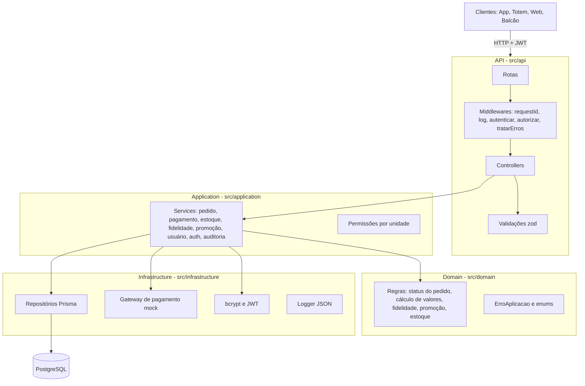

# Arquitetura

Aplicação **monolítica em camadas**, inspirada em uma Clean Architecture simplificada. Cada camada tem uma responsabilidade e as dependências apontam para dentro (API → Application → Domain). A Infrastructure é usada pela Application para acessar o banco e os serviços externos.



## Pastas

```
src/
  domain/            regras de negócio puras, enums e erro de aplicação (sem dependência de framework)
  application/       casos de uso (services) que orquestram regras, repositórios e transações
    services/
    permissoes.ts    regra de acesso por unidade
    paginacao.ts
  infrastructure/    detalhes técnicos
    banco/           Prisma Client e transações
    repositorios/    acesso a dados por entidade
    pagamento/       gateway de pagamento mock
    seguranca/       hash de senha e JWT
    config.ts        variáveis de ambiente
    logger.ts        log estruturado
  api/               interface HTTP
    rotas/           endpoints por recurso, com autenticação e autorização
    controllers/     leitura da requisição e montagem da resposta
    validacoes/      contratos de entrada (zod)
    middlewares/     requestId, log de requisição, auth, rate limit e erro padrão
    docs/            OpenAPI (Swagger)
  app.ts             montagem do Express
  server.ts          inicialização
prisma/              schema, migrations e seed
tests/               testes unitários das regras de domínio
postman/             coleção de testes da API
docs/                documentação técnica
```

## Decisões técnicas

| Decisão | Motivo |
|---|---|
| Express 5 | Simples e conhecido. A versão 5 encaminha erros de funções async para o middleware de erro sem `try/catch` em cada controller |
| Prisma ORM | Migrations versionadas, seed e tipagem automática das entidades |
| zod | Validação declarativa dos contratos de entrada, com mensagens em português |
| Transações (`prisma.$transaction`) | Pedido, itens, estoque, pontos e auditoria são gravados juntos ou nada é gravado |
| Update condicional para estoque e status | Evita condições de corrida em horário de pico (dois pedidos pegando o último item ou dois pagamentos no mesmo pedido) |
| Valores em centavos no cálculo | Evita erro de ponto flutuante em dinheiro |
| Gateway de pagamento isolado em `infrastructure/pagamento` | Para trocar o mock por um provedor real, basta alterar esse módulo |
| Erro padronizado no middleware `tratarErros` | Todas as falhas têm o mesmo formato JSON |
| Docker Compose | Ambiente reproduzível com API e banco em um comando |
