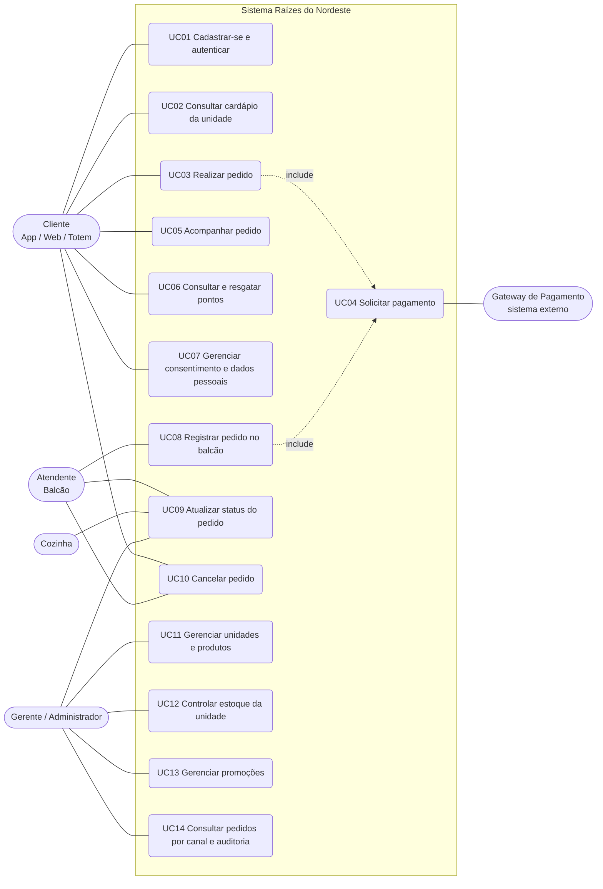

# Casos de Uso

## Diagrama

Observações:

- UC03 e UC08 incluem o UC04: depois de criado, o pedido precisa ser pago para seguir para a cozinha.
- Gerente gerencia apenas a própria unidade. Administrador gerencia toda a rede (unidades, produtos, funcionários, promoções e auditoria).

---

## UC03 - Realizar Pedido (feature crítica)

**Descrição:** o cliente (ou o atendente, no balcão) monta um pedido em uma unidade, informando o canal de origem.

**Ator principal:** Cliente (App/Web/Totem). **Demais atores:** Atendente (Balcão).

**Endpoint:** `POST /pedidos`

**Pré-condições**

1. Usuário autenticado com token JWT válido (perfil CLIENTE, ATENDENTE, GERENTE ou ADMIN).
2. Unidade ativa e produtos ativos cadastrados.

**Pós-condições**

1. Pedido gravado com status `AGUARDANDO_PAGAMENTO`, `canalPedido` e total calculado.
2. Estoque da unidade baixado (movimentação de SAIDA vinculada ao pedido).
3. Pontos resgatados debitados, quando houver.
4. Log de auditoria `PEDIDO_CRIADO` registrado.

**Fluxo principal**

1. O ator envia unidade, canal, forma de pagamento e itens.
2. O sistema valida o formato dos dados (canal obrigatório, quantidade inteira maior que zero, sem produtos repetidos).
3. O sistema verifica se a unidade existe e está ativa. [RN03]
4. O sistema identifica o cliente: o próprio usuário, se for CLIENTE, ou o `clienteId` informado pelo atendente.
5. Para cada item, o sistema verifica se o produto existe e se a unidade tem estoque suficiente. [RN01]
6. O sistema aplica a melhor promoção vigente de cada produto. [RN04]
7. Se houver `pontosResgatados`, o sistema valida consentimento e saldo e calcula o desconto. [RN05]
8. O sistema calcula subtotal, desconto e total.
9. Em uma única transação: grava o pedido e os itens, baixa o estoque, debita os pontos e registra a auditoria.
10. O sistema retorna 201 com o pedido criado.

**Fluxos alternativos e exceções**

| Situação | Resposta |
|---|---|
| `canalPedido` ausente ou inválido | 422 `VALIDACAO` |
| Quantidade negativa ou zero | 422 `VALIDACAO` |
| Sem token | 401 `TOKEN_AUSENTE` |
| Perfil COZINHA ou funcionário de outra unidade | 403 `ACESSO_NEGADO` |
| Unidade ou produto inexistente | 404 `UNIDADE_NAO_ENCONTRADA` / `PRODUTO_NAO_ENCONTRADO` |
| Estoque insuficiente | 409 `ESTOQUE_INSUFICIENTE`, com a quantidade disponível em `details` |
| Pontos sem consentimento ou saldo insuficiente | 409 `CONSENTIMENTO_NECESSARIO` / `PONTOS_INSUFICIENTES` |
| Estoque consumido por outro pedido ao mesmo tempo | 409, a transação é desfeita |

**Regras de negócio**

- RN01: não é permitido vender acima do saldo de estoque da unidade. A baixa usa um update condicional (`quantidade >= solicitada`) para evitar venda duplicada em concorrência.
- RN02: o canal do pedido é obrigatório e fica gravado para rastreabilidade.
- RN03: funcionários só registram pedidos na sua unidade.
- RN04: vale a promoção de maior percentual entre as da rede e as da unidade.
- RN05: cada 10 pontos valem R$ 1,00 e o resgate exige consentimento.

---

## UC04 - Solicitar Pagamento (feature crítica)

**Descrição:** o sistema envia a cobrança do pedido ao gateway de pagamento externo (mock) e atualiza o pedido conforme a resposta.

**Ator principal:** Cliente ou Atendente. **Demais atores:** Gateway de Pagamento (sistema externo simulado).

**Endpoint:** `POST /pagamentos`

**Pré-condições**

1. Pedido existente, com status `AGUARDANDO_PAGAMENTO`.
2. Usuário dono do pedido ou funcionário da unidade.

**Pós-condições**

1. Tentativa de pagamento registrada na tabela `pagamentos` com status, código da transação e payload do gateway.
2. Se aprovado: pedido em `RECEBIDO` e pontos creditados ao cliente com consentimento.
3. Logs de auditoria do pagamento e da mudança de status.

**Fluxo principal**

1. O ator envia o `pedidoId` (e, no mock, o campo `simulacao`).
2. O sistema verifica se o pedido pode receber pagamento. [RN06]
3. O sistema envia valor e forma de pagamento ao gateway mock.
4. O gateway responde APROVADO com o código da transação.
5. Em uma transação: o pedido passa de `AGUARDANDO_PAGAMENTO` para `RECEBIDO` (update condicional), o pagamento é gravado, os pontos são creditados e a auditoria é registrada.
6. O sistema retorna 201 com o pagamento, o novo status do pedido, os pontos ganhos e o payload do gateway.

**Exceções**

| Situação | Resposta |
|---|---|
| Gateway recusa (`simulacao: RECUSAR`) | 402 `PAGAMENTO_RECUSADO`. O pagamento fica gravado como RECUSADO e o pedido continua `AGUARDANDO_PAGAMENTO` para nova tentativa |
| Gateway indisponível (`simulacao: FALHAR`) | 503 `GATEWAY_PAGAMENTO_INDISPONIVEL`. A tentativa fica gravada como FALHA e o pedido não é alterado |
| Pedido já pago (nova tentativa ou clique duplo) | 409 `PEDIDO_JA_PAGO` (idempotência) |
| Pedido cancelado | 409 `PEDIDO_CANCELADO` |
| Pedido de outro cliente | 403 `ACESSO_NEGADO` |

**Regras de negócio**

- RN06 (idempotência): um pedido tem no máximo um pagamento aprovado. A troca de status usa `UPDATE ... WHERE status = 'AGUARDANDO_PAGAMENTO'`, então duas requisições simultâneas não aprovam o mesmo pedido duas vezes.
- RN07: pontos são creditados só quando o pagamento é aprovado e o cliente consentiu (1 ponto por real).
- RN08: se o pedido for cancelado depois de pago, o pagamento vira ESTORNADO e os pontos ganhos são estornados.

---

## UC09 - Atualizar Status do Pedido

**Atores:** Cozinha, Atendente, Gerente/Administrador. **Endpoint:** `PATCH /pedidos/{id}/status`

| De | Para | Quem pode |
|---|---|---|
| AGUARDANDO_PAGAMENTO | RECEBIDO | Somente o sistema, quando o pagamento é aprovado |
| RECEBIDO | EM_PREPARO | COZINHA, GERENTE, ADMIN |
| EM_PREPARO | PRONTO | COZINHA, GERENTE, ADMIN |
| PRONTO | ENTREGUE | ATENDENTE, GERENTE, ADMIN |
| AGUARDANDO_PAGAMENTO ou RECEBIDO | CANCELADO | Rota `/cancelar`: CLIENTE (dono), ATENDENTE, GERENTE, ADMIN |

Uma transição fora da tabela retorna 409 `TRANSICAO_DE_STATUS_INVALIDA`, e um perfil não autorizado para o status pedido recebe 403.
