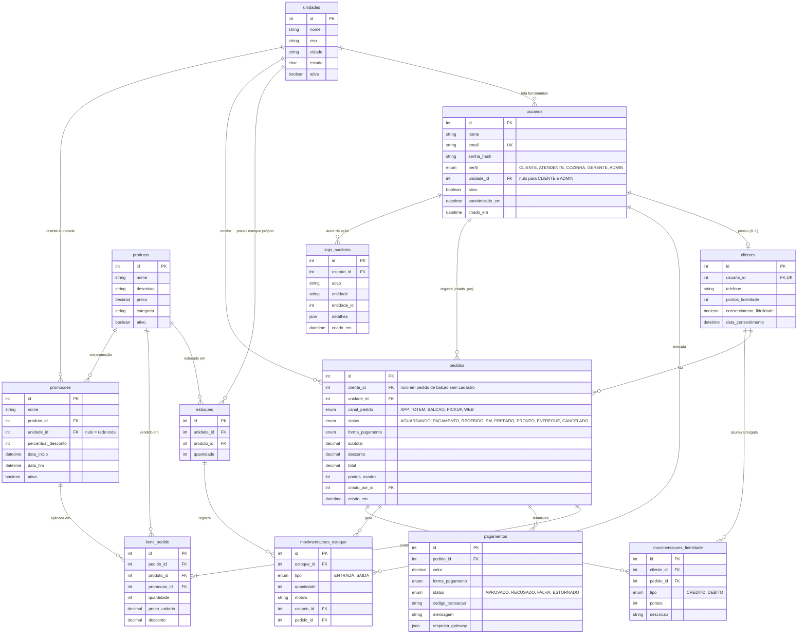

# DER - Modelo de Dados

Banco relacional PostgreSQL. As tabelas são criadas pela migration do Prisma em `prisma/migrations` e o modelo está em `prisma/schema.prisma`.

## Principais restrições

| Restrição | Onde | Motivo |
|---|---|---|
| `usuarios.email` único | usuarios | Login por e-mail |
| `clientes.usuario_id` único | clientes | Relação 1:1 entre usuário e cliente |
| `(unidade_id, produto_id)` único | estoques | Cada unidade possui um único saldo por produto (estoque próprio) |
| `canal_pedido` obrigatório (ENUM) | pedidos | Multicanalidade e rastreabilidade por canal |
| Índices em `canal_pedido`, `status` e `unidade_id` | pedidos | Consultas e filtros mais rápidos em horário de pico |
| Pagamento em tabela separada | pagamentos | Pagamento desacoplado do pedido: um pedido pode ter várias tentativas (recusado, falha, aprovado) |
| Valores monetários `DECIMAL(10,2)` | pedidos, itens, produtos, pagamentos | Evitar erro de arredondamento de ponto flutuante |
| Exclusão lógica (`ativa`/`ativo`) | unidades, produtos, promoções | Preserva o histórico dos pedidos já realizados |

## Diferenças em relação ao DER inicial

O DER inicial (entregue na primeira parte do trabalho) foi evoluído durante a implementação:

- Nomes de tabelas e colunas traduzidos para o português, iguais aos do banco.
- A tabela `menus` foi substituída por `estoques`: o cardápio da unidade passa a ser formado pelos produtos que possuem estoque naquela unidade. Assim o produto é cadastrado uma vez só e cada unidade controla o próprio saldo.
- Foram adicionadas as tabelas `movimentacoes_estoque`, `pagamentos`, `movimentacoes_fidelidade`, `promocoes` e `logs_auditoria`, necessárias para o controle de estoque, o pagamento mock, a fidelidade, as promoções e a auditoria.
