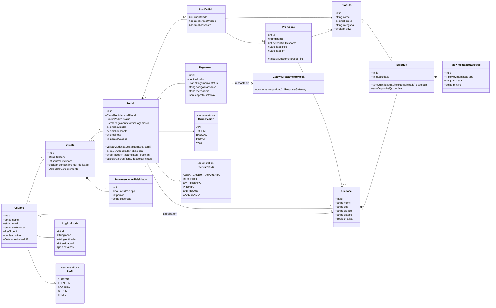

# Diagrama de Classes (domínio)

As regras de domínio ficam em funções puras na pasta `src/domain`:

| Arquivo | Regras |
|---|---|
| `pedido.ts` | Transições de status permitidas, perfis que podem definir cada status, cancelamento, pagamento e cálculo de subtotal/desconto/total |
| `estoque.ts` | Quantidade suficiente e disponibilidade no cardápio |
| `fidelidade.ts` | Pontos ganhos (1 por real), valor do ponto (R$ 0,10) e validação de resgate com consentimento |
| `promocao.ts` | Escolha da melhor promoção e cálculo do desconto |
| `usuario.ts` | Máscara de e-mail para logs e dados de anonimização |
| `dinheiro.ts` | Conversão entre reais e centavos para evitar erros de arredondamento |
